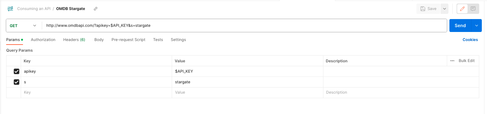

# ![[Consuming an API] - Consuming an API](./assets/tktk-hero.png)

**Learning objective:** By the end of this lesson, students will be able to make a request to a third-party API using Postman and cURL.

## Consuming an API

For this lesson, we will use two tools to consume from the OMDB API. The first is [Postman](https://www.postman.com/). Postman is a tool that allows us to request APIs and see the response. The second is [cURL](https://curl.se/). cURL is a command line tool that will enable us to make requests to APIs from the command line.

## Consume an API using cURL

Looking at the OMDB documentation, we can see that the base URL for the API is `http://www.omdbapi.com/`. We can also see that the API requires an API key. We can pass the API key as a query parameter in the URL. Let's make a request to the API using cURL.

First, we have to save the API key as an environment variable. In the terminal, run the following command:

```bash
API_KEY=YOUR_API_KEY
```

We can test that the environment variable was set correctly by running the following command:

```bash
echo $API_KEY
```

> 📚 Even though this is a local environment, and we don't have to save our API key as an environment variable, we will do it anyway. This is to get us in the habit of doing it when working with APIs in our applications.

Once the environment variable is set, we can request the API. Let's look at the documentation to see if we can find anything on Stargate.

There are two different URLs to which we can make requests. One is for all movie data, and the other is for poster images. Let's make a request to the movie data URL. That gives us the following base URL along with the API key query parameter:

`"http://www.omdbapi.com/?apikey=[yourkey]&"`

We will need to replace the placeholder of `[yourkey]` with our API key, and we still need to query for Stargate. Looking back at the documentation, we can see that we can search for movies by title using the `s` query parameter. Let's add that to our URL:

`"http://www.omdbapi.com/?apikey=$API_KEY&s=stargate"`

Perfect! Now we have a URL, we can make a request. To make a GET request using cURL, we must pass the URL as an argument to the `curl` command. Let's run the following command:

```bash
curl "http://www.omdbapi.com/?apikey=$API_KEY&s=stargate"
```

We should get back a bunch of data about Stargate. We can see that the data is in JSON format, and by default, it's all squished together and hard to read. Luckily, cURL has a built-in flag to format the JSON for us. Let's run the following command:

```bash
curl "http://www.omdbapi.com/?apikey=$API_KEY&s=stargate" | json_pp
```

> 📚 The `|` character is called a pipe. It takes the output from the command on the left and passes it as input to the command on the right. In this case, we are taking the output from the `curl` command and passing it as input to the `json_pp` command.

## Consume an API using Postman

Now that we have requested the OMDB API using cURL let's request using Postman. Open up Postman and create a new request. In the URL bar, enter the following URL:

`"http://www.omdbapi.com/?apikey=$API_KEY&s=stargate"`

Once you have added the URL, you should see the Query Params section of the request update with the `spiky` and `s` query parameters. The `apikey` query parameter should have the value of your API key, and the `s` query parameter should have the value of `stargate`. If you don't see the query parameters, make sure you have the Params tab selected.



You can select the value of the `apikey` query params and replace `$API_KEY` with your API key. Once you have done that, click the Send button. You should get back the same data we got back when we made the request using cURL. This time, the data is formatted for us and is much easier to read.

## You do: Consume an API using Postman

Now that we have made a request to the OMDB API using both Postman and cURL, it's your time to venture forth and try this out yourself. Using the OMDB API documentation, make a request to the API using both Postman and cURL. Try making a request to the movie data URL and the poster images URL. Try searching for different movies and see what data you get back.
