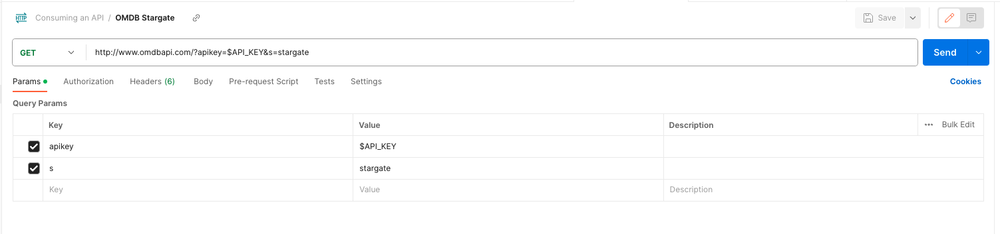

<h1>
  <span class="headline">Consuming an API</span>
  <span class="subhead">Methods for Consuming an API</span>
</h1>

**Learning objective:** By the end of this lesson, students will be able to make a request to a third-party API using Postman and cURL.

## Consuming an API

Now that we've secured our API key, it's time to put it to use by testing the API. Before diving into the development of a full-fledged project, it's wise to ensure that the API offers the data and functionality we anticipate. Imagine the frustration of building an entire app only to find that the API doesn't work as expected!

To efficiently test an API without setting up a complete project, we can turn to tools like Postman and cURL.

- [cURL](https://curl.se/). cURL is a command line tool that enables us to make requests to APIs directly in the terminal.

- [Postman](https://www.postman.com/). Postman is a tool that allows us to make requests to APIs from the app's interactive dashboard.

These tools provide an ideal testing environment where we can explore the API's responses, utilize our key, and understand the data structure without any initial development. In the next section, we'll walk through how to test an API using both Postman and cURL, giving you two new methods to test future APIs.

## Consume an API using cURL

Looking at the [OMDb documentation for usage](https://www.omdbapi.com/#usage), we can see that the base URL for this API is `http://www.omdbapi.com/`. We can also see that the API requires an API key. As outlined in the documentation, we can pass the API key as a query parameter in the URL, like so, `http://www.omdbapi.com/?apikey=[yourkey]&`.

Let's build a commend together that makes a request using this URL. First, we have to save the API key as an environment variable.

The terminal environment (often a command-line interface or shell in operating systems like UNIX, Linux, or macOS, and the Command Prompt or PowerShell in Windows) has the ability to save variables through the concept of environment variables. TO set a variable in your terminal just type it as you would in a .env file `MY_VAR=something_secret`.

By default, environment variables are session-specific. They exist only as long as the terminal session is active.

### Setting a variable

In the terminal, run the following command:

```bash
API_KEY=your_api_key
```

So, for example, if the API key you received from OMDb is `abc123456`, you would enter:

```bash
API_KEY=abc123456
```

We can test that the environment variable was set correctly by running the following command:

```bash
echo $API_KEY
```

> ❗️ To access the value stored in the variable, be sure to prepend a `$` to the variable name.

> Even though this is a local environment, and we don't have to save our API key as an environment variable, we will do it anyway since it is following best practices. This is to get us in the habit of doing it when working with APIs in our applications.

Once the environment variable is set, we can make a request to the API using that variable.

### Making the request

Let's review the [documentation](https://www.omdbapi.com/#usage) for instructions on how to make requests. You'll notice there are two different URLs to which we can make requests.

- One is for **_movie data_**: `http://www.omdbapi.com/?apikey=[yourkey]&`
- The other is for just **_movie poster images_**: `http://img.omdbapi.com/?apikey=[yourkey]&` _(requires a paid account)_

Let's make a request to the **movie data** URL for the TV series **Stargate**.

Start with the base URL:

```bash
http://www.omdbapi.com/?apikey=[yourkey]&
```

Then replace the placeholder of `[yourkey]` with your `API_Key` environment variable:

```bash
http://www.omdbapi.com/?apikey=$API_KEY&
```

> ❗️ Notice the `$` when using the variable `API_KEY`.

Now we need to specifically query for **Stargate**. Referencing the [documentation for parameters](https://www.omdbapi.com/#parameters), we find that we can search by **_title_** using the `s` query parameter.

Let's add that to the end of our base URL:

```bash
http://www.omdbapi.com/?apikey=$API_KEY&s=stargate
```

> 📚 You might be curious about why the API provider added an `&` symbol at the end of the base URL. This is typically done to make it easier for users to append additional parameters to the query string.

**Perfect!** Now we have a completed URL and can make a request.

To make a **GET** request using **cURL**, we must pass the URL as an argument to the `curl` command formatted like a string within `" "` quotes.

Let's run the following command:

```bash
curl "http://www.omdbapi.com/?apikey=$API_KEY&s=stargate"
```

This should return a condensed text object containing data on **Stargate**. If you examine closely, you'll see that the data is actually in **JSON format**, but it's not formatted for the shell environment and therefore very hard to read. Luckily, cURL has a **built-in flag** to format the JSON for us so that its more readable in the terminal.

Let's run the command again with a flag:

```bash
curl "http://www.omdbapi.com/?apikey=$API_KEY&s=stargate" | json_pp
```

> 📚 The `|` character is called a pipe. It takes the output from the command on the left and passes it as input to the command on the right. In this case, we are taking the output from the `curl` command and passing it as input to the `json_pp` command.

**Much better!**

## Consume an API using Postman

Now that we have practiced making a request using cURL, let's make the same request using **Postman**.

Open up the Postman application and create a new request tab. In the URL bar, enter the same URL as before:

```bash
http://www.omdbapi.com/?apikey=$API_KEY&s=stargate
```

> Note: The URL should not be formatted in quotes for Postman.

Once you have added the URL, you should see the Query Params section below the address bar automatically update with the `apikey` and `s` query parameters. If you don't see the query parameters, make sure you have the `Params` tab selected.

It should look like the following:



Next we'll need to update the value of `API_KEY` in our URL since Postman does not have access to our environment variables in the terminal. Select the value for `apikey` in the query params section and replace `$API_KEY` with your **_actual_** API key.

The `s` query parameter should already have the value of `stargate` from our previous example.

Once you have updated `apikey`, click the `Send` button. You should get back the same data as before. This time, the data will already be formatted for us by Postman and is much easier to read.

## You do: Practice making requests

Now that we have made requests using both **Postman** and **cURL**, it's your turn.

Using the OMDb API documentation, make another request to the API using both Postman and cURL.

- Make a cURL request to the movie data URL with a different movie title.
- Make a postman request to the movie data URL with some extra parameters like: `http://www.omdbapi.com/?apikey=[yourkey]&t=Game of Thrones&Season=1&Episode=1` alter the parameters to see different data.
